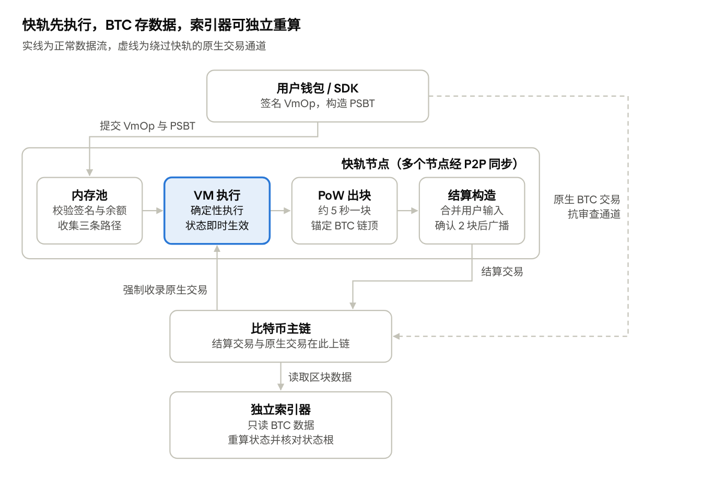

# Architecture

What each crate and directory of this repository does. The protocol itself is in [SPEC](SPEC.md), whose §3 shows the
system's four parts and how data flows between them; a D-number names an entry of [DECISIONS](DECISIONS.md), and an
M-number the milestone that built something ([HISTORY](HISTORY.md)).

In short: wallets sign operations with their Taproot keys and send them to a node (path B, fees in KSA) or put them in
their own Bitcoin transactions (path C). Nodes mine fast-lane blocks with Argon2id into a GHOSTDAG block DAG, execute
them in a WebAssembly VM, and land every block's header and body on Bitcoin in settlement and republish payloads, whose
producers and carriers are paid in KSA when the data lands. Finality is determined from Bitcoin's chain data alone, and
the indexer, which talks only to bitcoind, rebuilds the block DAG and the state from those payloads and checks every
state root the nodes committed to.

## Crates

- `ksana-primitives`: consensus types (block header v2 carries `parents`, D-063; the settlement a block carries is `SettlementTxs { commit, reveal }`, D-081),
  Borsh encoding / decoding (length limits checked first), hashing (`op_id`, block hash), the compact encoding of the header sequence in a payload (`compact.rs`, D-075; not written when the state root is unchanged, D-079; at most `MAX_SETTLEMENT_HEADERS`, checked on the count, `read_headers(reader, max_count)`, D-100), the compact encoding of bodies and entries (`compact_entries.rs`:
  per-payload key dictionary, varint, VmOps without the chain ID, D-080; `Payload::encode` / `decode` need the network params) and carried bodies (`Body`, `check_bodies`, D-077),
  protocol parameters `params` (including `ANCHOR_DEPTH`, which is not in the spec, D-056; mining algorithm and GHOSTDAG parameters, D-062, D-063; two-speed difficulty `EMPTY_BLOCK_DIFFICULTY` /
  `MAX_EMPTY_BLOCK_WEIGHT`, the weight by empty-block streak `empty_block_weight(streak)` / `block_streak` / `block_weight(header, sp_streak)` and the weight-based
  reward slots `block_rewards_at`, D-084, D-090; block reward and the KSA max supply,
  `MAX_UNLOCK_BATCH`, D-074; halving periods that double `reward_interval_doublings` times and then keep their length (`reward_period_at`, `block_reward_at`, the bound `max_total_rewards`; mainnet 2, devnet / signet 0), D-105; block share `block_share_bps` / `block_share_end` (base values, also in `Rules` / `Upgrade`) and the per-slot split
  `block_share_at` / `block_rewards_split_at`, D-089; carrier reward `carrier_bps` / `carrier_fee_bps` (also in `Rules` / `Upgrade`) and `carrier_repost_delay`, `block_carrier_at` / `carrier_fee_at`, the three-way `RewardSplit`, republish payload `Payload::Headers.payee`, D-095; `MAX_SETTLEMENT_HEADERS` 500, D-075; the upgrade schedule `upgrades` and the `Rules` by DAA score, D-076;
  the bound on the timestamp relative to the anchor BTC block's time `max_timestamp_ahead_of_anchor_secs`, D-083); assets (`asset.rs`: the limits of a name, a symbol and the decimals,
  `check_meta`, the issuer capability bits `CAP_*` and the status flags `STATUS_*` with their names, D-121).
- `ksana-crypto`: BIP340 tagged hash, Schnorr signing / verification, accounts (`account_of` = the BIP86 output key, i.e. the witness program of the Taproot address, D-092; account ↔ address
  and text parsing in `account.rs`), VmOp signatures (BIP340 with the tweaked private key; BIP322 simple accepts only the P2TR key-path of the account's address, `bip322.rs`, D-052, D-092;
  the path C signing message ends with the first input of the carrying transaction, the `*_native_*` interfaces, D-086), Merkle utilities (`entries_root`, RFC 6962).
- `ksana-state`: JMT (jmt 0.12) + RocksDB, version = fast-lane height, commit / rollback / pruning / fixed-version read view / clear (`reset`, for rebuilding from genesis, D-093),
  `state_root` (D-024), the root of a block's writes on top of an older kept version without committing them (`preview_root_at`, for the finality verdict, D-101); the RocksDB memory bounds every
  store of the node and the indexer opens with (`rocks.rs`: `DbMemory::open`, write buffers of 4 MiB per column family and 16 MiB per database, one 32 MiB block cache per process holding the
  index blocks too, D-103).
- `ksana-vm`: wasmtime 49 engine configuration, static checks at deployment (no floating point, import allowlist, stack frame estimation), runtime stack metering inserted before compilation (`instrument.rs`,
  wasm-encoder, D-073), host functions and the gas table (`docs/ABI.md`; `native_tx` reads the BTC transaction carrying the path C op, D-078; the asset management functions
  `asset_create` / `asset_freeze` / `asset_allow` / `asset_pause` / `asset_renounce` and the queries `asset_policy` / `asset_status`, charged before the host acts, D-121;
  the funds a contract attaches go through the provided `Host::transfer_attached`, so that the execution layer records them apart from its payments, D-122).
- `ksana-execution`: block execution (shared by node and indexer): a main-chain block first executes the blocks it merges in lenient mode, then its own entries in strict mode (D-063),
  entry order and gas limits, the fee and nonce rules of paths B / C (path A and fee debt are deleted, D-078; a forced-inclusion entry naming no native transaction of the anchor chain that carries its op is invalid,
  and makes a block merging it invalid too, `BtcView::native_input`; unlock entries of merged blocks are skipped; D-100; a forced entry's authentication `check_native_op` is shared with the node, D-104), sponsored fees recorded by acceptance position with cumulative unlock (`Unlock { height, index }`,
  at most one per block, unlock cursor, `BlockEnv.unlockable` is the unlockable segment given by the node / indexer, D-074, D-079), block rewards paid out at unlock (main-chain blocks and blue merged blocks,
  halving by DAA score in periods that may double in length (D-105), capped at the max supply; empty blocks write no state, D-079; each block takes w reward slots by weight `block_rewards_at`, `UnlockItem.weight` can only be 1 or the empty-block weight of some
  streak `is_block_weight`, D-084, D-090; each slot is split by `BLOCK_SHARE_BPS` between the block share account from the genesis config (state key 0x0B) and the producer, D-089; when there is a carrier, each slot is further split by `CARRIER_BPS` out of the producer's share to the carrier (`BtcView::carrier`), and the sponsored fee is split between them by `CARRIER_FEE_BPS`,
  capping order share → carrier → producer, D-095),
  the built-in Account / Asset modules (an asset's metadata with its symbol and the capabilities its issuing contract declared when creating it, mint, freeze, allowlist and pause,
  only given up; an account's status flags for an asset at 0x0C; `transfer` / `issue` / `burn`, through which every movement passes, refuse with `rejected:` what the capabilities
  stop, the issuing contract exempt, no clawback; `can_send` / `can_receive` shared with the RPC, D-121),
  the genesis state (allocation cap, block share account) and the genesis config file (`genesis_file.rs`, `block_share_account` may be omitted);
  the rules that vary with the protocol version are in `BlockEnv.rules` (the main-chain block's rules); the static checks of entries follow the block's own rules (D-076);
  a receipt lists the op's changes to built-in assets in the order it made them, each with the number of events before it (`AssetChange` / `ChangeKind` in `state.rs`, recorded
  by `OpHost` and the executor once a builtin succeeded, in the op's log beside its events; a movement of 0 and KSA's fees, unlocks and rewards are none; not consensus, D-122).
- `ksana-consensus`: the `Consensus` trait and PoW: a replaceable mining algorithm (`PowAlgorithm`, D-062; the network's algorithm is Argon2id, `Argon2id`, parameters in
  `Params::pow_algorithm`, the salt includes the chain ID, `Sha256d` is only for tests and benchmarks, a computation failure is the local fault `PowUnavailable`, the number of nonces per solve attempt
  `solve_chunk`, D-094), U256, compact bits,
  work, aserti3-2d (by `daa_score`, with the genesis block as the anchor, D-025/D-026), two-speed difficulty (the empty-block weight doubles from N up to N_MAX with the empty-block streak on the selected chain: effective target =
  target / weight, work and DAA score scale by weight, `Consensus::streak` / `weight(header, sp_streak)` / `next_bits(sp, daa_score, weight)` /
  `check_header(sp, daa_score, weight, header)` / `effective_target`, D-084, D-090), header version per the upgrade schedule (D-076), timestamp rules (including the anchor bound
  `check_anchor_time`, D-083), solving; the GHOSTDAG block DAG (`ghostdag.rs`: selected parent,
  merge set and coloring, blue score / blue work, merge limits, DAA score accumulating the weights, each block's empty-block streak and `parent_streak`, sync queries by sort key `(blue_work, hash)`, D-063, D-084, D-090;
  the merge-depth root rule `GhostdagError::MergeDepthRoot`, pruning `BlockDag::prune` (keeps the pruning point and its future; a computation needing a pruned block is `GhostdagError::Pruned`,
  never invalid), `chain_floor`, `checkpoint` / `restore`, `GhostdagParams::min_pruning_depth` = 3 × (merge depth + K) + 1, selected-chain tips ordered by the fork-choice key, D-097;
  the fork-choice key `chain_key` = `(chain_work, hash)` with `chain_work = blue_work + work` for the selected parent, the main chain and the finality candidate, D-100).
- `ksana-btc`: KSN1 data output (D-032) and the envelope in the Taproot witness (`envelope.rs`, D-081; a transaction is recognized only when its two kinds of data carrier total exactly one, OP_RETURN
  carries only path C, the envelope carries only settlement and republish payloads), native transaction recognition and the forced-inclusion window (D-036; coinbase excluded, `first_input` / `with_native_op`,
  D-086), signature verification of BTC inputs (`spend.rs`: P2TR key-path and
  P2WPKH, BIP86 tweak), assembly / signing / verification of settlement transactions (D-034; since D-078 only the producer's inputs; since D-081 two transactions, commit / reveal,
  `SettlementPair`; every input's `nSequence` is `PRODUCER_SEQUENCE`, D-100; the CPFP child spending the reveal's P2A output and a funding UTXO, `cpfp_child`, D-102), the correspondence between blocks and settlement payloads (`payload.rs`, D-043, D-063; bodies must land on BTC, bodies carried by payloads, D-077; the room for a block's entries `body_room`, D-098;
  a body must fit in a payload alone, measured by the upper bound `max_body_len`, `check_body_fits`, and an attached payload's headers anchor at or below its block, `settlement_belongs_to`, D-100); the BTC tracker, snapshots, the settled closure, the backlog limit and the execution-layer view
  (`tracker.rs`, shared by node and indexer, D-049; the pending payloads of one transaction share one copy of it, D-098; a payload counts only when its headers anchor below its BTC height, `payload_counts`, D-100; a `Landing` for each time a block's data lands on chain (height, index within the block, payload sender `Sender`) and the carrier determination
  `carrier_of` / `BtcView::carrier` (`AnchoredView` needs the network params), D-095; the unlockable segment `unlock_segment` and the producer's unlock target `unlock_target`, D-079;
  `AnchoredView::history` for syncing historical blocks, answering from the current chain when the anchor block has been reorged away on BTC, D-056;
  the transactions that landed each block's data: the payloads carrying the same body, `KnownBlocks::block_data`, D-077; the `observe_payload` callback when a payload is scanned, with the snapshot being
  built); the header-only block DAG (`headers.rs`: headers that have appeared in BTC payloads, GHOSTDAG and main-chain selection same as the node, the finality lower bound, shared by node and indexer,
  D-082; the disqualified blocks with the basis of their verdicts, `disqualify` / `requalify`, D-101; every main-chain choice takes the BTC snapshot, a block anchored, or merging a block anchored,
  off its best chain is ineligible, `unanchored`, and `reselect` retreats below such a main-chain block above the floor, D-104) and the BTC-anchored finality determination (`finality.rs`: determined BTC height by BTC height, paused when it cannot be decided,
  rolled back on BTC reorg, D-082; a height it paused at determined again from the start when it resumes, D-114; only a valid block is decided final: a block anchored, or merging a block anchored, off the BTC best chain is excluded before anything else is asked
  (`Exclusion::Unanchored`), a candidate meeting the landing condition is judged first, an invalid one is excluded at that BTC height together with its
  selected-chain future and the best chain is chosen again, a missing verdict pauses (`Outcome::validating`), exclusions are revoked by BTC reorgs and pruned with the DAG, `Validity`,
  `excluded_at`, D-101; the BTC-final tip as reported, `Finality::btc_final` / `BtcFinal`: the highest finalized block determined at a BTC block with `BTC_FINALITY_CONFS`
  confirmations, the one reported before kept while its determination stands, `taken_back` for the alert, D-114) and the verdict it asks for (`verdict.rs`: the block executed as a main-chain block on its selected parent, the same execution as the indexer's; a verdict holds while its
  `basis`, the best chain's block at the anchor height, is unchanged, `Verdicts` / `StoredVerdicts`, kept on disk with `VERDICT_VERSION`; a failed execution in anchor-invalid mode is no verdict, D-101); determining fast-lane blocks' bodies from BTC payloads
  (`bodies.rs`: candidate bodies, derivation and conversion of forced-inclusion entries, anchor-invalid blocks, shared by node and indexer, D-077, D-093; the forced-inclusion check of an anchor-invalid block
  when it is accepted, `check_stale_entries` over `stale_range`, from the window start to `h(tip − ANCHOR_DEPTH)`, D-100); `BtcClient` (bitcoind RPC, based on
  corepc-client; `test_accept` checks a set of transactions as a package, `broadcast_all` broadcasts them one after another; `estimate_feerate` is estimatesmartfee in sat/vB for the local fee policy, D-102, and `mempool_info` getmempoolinfo's virtual size and minimum fee rate, D-117;
  a `scan_utxos` of the UTXO set is kept per BTC tip for every caller, and `RpcClient::with_wallet` lists one script's outputs from a watch-only wallet instead, `wallet_watches`, D-109); the in-memory mock chain `MockBtc`
  under the `mock` feature (for tests; it mines by the fee rate of ancestor packages, has no RBF, and takes fee estimates and a mempool minimum fee rate from the test, `set_fee_estimate` /
  `set_min_feerate`, D-102, and what getmempoolinfo answers, `set_mempool_info`, D-117; `reconnect` goes back to a branch a reorg left, D-104).
  Pruning (D-097): the policy and the checkpoint files (`prune.rs`: `Pruning`, `PRUNE_BTC_MARGIN` 144, `PRUNE_STEP` 1 000, Borsh + SHA-256 written atomically), the main chain's summaries as a window
  over a history on disk (`MainChain` / `MainHistory`), `BtcSnapshot::prune`, `HeaderDag::prune`, `Finality::prune` / `decided_by` / `root_revoked`, `Bodies::prune`, the records of each for the
  checkpoints, `TrackerError::TooDeep` (a BTC reorg below what is kept) and `BtcTracker::reset`.
- `ksana-mempool`: the entry pool (local policy): admission checks (relay floor `min_relay_token_fee`), replacement and capacity, ordering by nonce chain and fee rate (sponsored fee / cost, cost =
  max(encoded bytes, bytes converted from `max_gas`), `op_cost` / `fee_rate`), packing candidates down to the packing floor (`min_token_fee`, `min_fee_per_kib`) (M23); a byte cap (`max_bytes`), eviction by standing
  instead of rejecting newcomers when full, a limit on ops behind a nonce gap (`max_gapped_per_account`), and the re-check of balances and rules after chain changes in `remove_committed` (M26, D-098);
  the nonces the path C ops waiting for forced inclusion take in turn from the account nonce on, passed by the node in BTC order, are no gap (`set_forced`, D-104);
  a replacement raises the sponsored fee by `replacement_bump_percent` (10) of it and by the relay floor at least (`Policy::replacement_fee`), the generation moves only for a
  change that can alter the packing candidates (an op behind a nonce gap or after one below the packing floor never does; `mark_changed` when the tip moved while an op was
  admitted), and `candidates_by` takes each account's nonce from the caller (D-130).
- `ksana-rpc`: the JSON-RPC interface, JSON types and server (jsonrpsee, HTTP + WebSocket, `docs/RPC.md`); the node implements `Backend`; the operation listings `getAccountOps` /
  `getLatestOps` with the position cursor `OpPosition` (`height:slot:entry`, limit 1 to 500, D-111); `getAsset` with the symbol, the capabilities and the pause, and
  `getAssetStatus`, an account's flags and whether it can send and receive an asset (D-121); the standards index's `getContract`, `getAccountAssets`, `getToken`,
  `getTokenHolders`, `getNfts` and `getApprovals`, paged by `after`, a page's `next`, hex of a fixed length for each listing (D-120); a receipt's `asset_changes`
  (`AssetChangeJson`, `null` when the node did not record them, D-122); the limits of the node's and the indexer's servers, `server_config` (batches of at most 64 calls, bodies of
  1 MiB, responses of 10 MiB, 100 connections, 16 subscriptions per WebSocket connection, D-132).
- `ksana-p2p`: the libp2p network layer (D-040): gossipsub broadcast of blocks and ops (the node reports Accept / Ignore / Reject after validation), `/ksana/sync/2` sync
  (Status includes the DAG tips, GetBlocks batched by cursor, GetBlock to fetch missing parents, GetMempool, D-063), scoring and banning, static bootstrap and redial,
  isolation control for tests (`block_peer`; the queued gossip of banned or blocked peers is dropped unvalidated, D-098); its own thread and tokio runtime.
  The local bounds of D-132: messages, requests and connections counted by source (`limit.rs`: `Source`, the address a peer connected from, an IPv4 address or an IPv6 /64, `IpGroup`, or
  the peer for a loopback, private or link-local address), D-059's token buckets by source, kept across reconnections; inbound connections capped in all, in the handshake, per address
  (`gate.rs`, before the handshake, with the addresses banned along with a peer banned by score) and per peer (`ConnectionLimits`); a gossip op over the network's `MAX_OP_BYTES`
  (`P2pConfig::max_op_bytes`) rejected before decoding; the gossip awaiting a verdict within a byte budget per topic and a quarter of it per source (`Budget`); inbound sync requests
  served 4 at a time, 16 in flight per source, the responses being sent within a byte budget (`Serving`), 8 sync streams per connection; requests read up to `wire::MAX_REQUEST_BYTES`,
  the responses to `Status` and `GetMempool` within `wire::response_limit`.
- `ksana-node`: the node library and binary: block storage (including side-chain blocks), block DAG (GHOSTDAG) / main-chain selection by `(chain_work, hash)` (D-100), never taking a block the finality determination would exclude under the current BTC chain (its anchor, or a merged block's, off the BTC best chain; a historical block from a peer is also bound by the anchor height limit of new blocks, D-101), retreating, whatever the depth, below a main-chain block above the finalized tip that a BTC reorg made so (`retreat_from_unanchored`, from `update_virtual`, `commit_block` and, once per BTC tip after a BTC sync, `Chain::reselect`, D-104; `commit_block` also discards its own block when a BTC reorg synced after the template took the block's anchor, or a merged block's, off the best chain) / reorg / orphan pool (checked before keeping, capped by `MAX_ORPHAN_BYTES`, D-098; a body that does not fit in a payload is invalid, D-100) / the refusals of blocks delivered by sync, remembered under the BTC tip, with the BTC and settlement checks before the signatures (`Refusals`, M27; a block missing a parent refused for itself is refused with it, and remembering such a refusal drops the orphans waiting for the block, `refused_with_parent`, D-104) / crash recovery (`chain.rs`, D-041, D-063), BTC tracking and scanning
  (`btc.rs`: snapshots, anchored view, settled prefix), the block production loop (anchoring, forced inclusion, unlock, path B, funding and signing of the settlement transactions (two, commit / reveal, D-081);
  settlement batching: `Chain::payload_carry` and `Carry::settlement_due`, turned off by `--no-settlement-batching`, D-077; templates leave out blocks with a merge hazard (always a block anchored off the BTC best chain, D-101), `Chain::merge_hazard`, and merged blocks whose
  execution fails until the BTC tip changes, `ProducerCache`; below the tips anchored off the BTC best chain templates try the parallel blocks a retreat left behind, `frontier`, D-104;
  unlock and path B entries only within `ksana_btc::payload::body_room`, D-098; a change of the entry pool's generation makes the running template stale only once it has been
  solved for `POOL_REFRESH_RATIO` (4) times as long as building it took, and the account nonces of the packing candidates are read once per main-chain tip, `ProducerCache`, D-130),
  delayed broadcast of settlement transactions (D-037),
  op admission and entry pool maintenance (`ops.rs`; after every main-chain change and BTC sync the pool gets the nonces of the path C ops waiting for forced inclusion, only of ops passing `ksana_execution::check_native_op` (verdicts kept by txid) and from the first `NATIVE_CONFIRMATIONS + ANCHOR_DEPTH + BTC_FINALITY_CONFS` BTC heights the next blocks force, D-104), network integration (`net.rs`; `Status` leaves out the DAG tips anchored, or merging a block anchored, off the BTC best chain, and carries the blocks below them that templates merge, D-104; a `GetBlocks` loads only the blocks that fit a response, D-132), rescue settlement, header and body republishing (when a lighter competing chain appears on BTC, republish immediately up to the main-chain tip,
  `Chain::btc_competitor`, D-091, of a tip only the part below its first block anchored off the BTC best chain or excluded, D-104; a settlement claim in the BTC mempool holds a rescue back only when checked and for `CLAIM_PATIENCE`, D-098, the block's own waiting settlement on the same terms, D-102; a settlement confirmed without counting is rescued, M27),
  CPFP bumps of the pairs this node sent once they wait `BUMP_AFTER` BTC blocks below its fee rate (`Rescuer::bump`, D-102; not for a pair whose block left the main chain, D-104, nor for one whose block's
  data has landed; a pair whose P2A output another party's transaction holds, its child refused, goes out again in a new pair of this node's at the bump's rate, in its place as the block's rescue or as the
  republish, `Rescuer::send_again`, D-131) and the funding UTXO pool
  (`rescue.rs`, D-045, D-047, D-075, D-077; the funding inputs of pairs dropped while in the BTC mempool stay reserved until they leave it, `Chain::linger`, D-104), the funding outputs from a scan per
  BTC tip or a watch-only wallet (`--btc-funding-wallet`, required on signet and mainnet; a failed scan costs the blocks their settlements until the next anchor or `FUNDING_RETRY`, not the blocks, D-109), the fee rate
  of this node's BTC transactions (`producer::FeePolicy`: estimatesmartfee within the floor and the cap, the next-block target while racing a competing chain, D-102; outside a race the floor while bitcoind's mempool holds at most `ROOMY_MEMPOOL_VSIZE`, `room_rate`, with bumps at `estimated_rate` and, once a pair has waited `BUMP_AFTER` BTC blocks with room, at least at `escalated`, the pair's own rate doubled for every such block from the `BUMP_AFTER`-th on, D-117),
  BTC-anchored finality (`chain.rs`: determined after every BTC sync, the main chain must pass through the finalized blocks, with a forced switch when necessary, the blocks the determination waits for are added to those requested from peers,
  `finalized` / `is_final` (the determined tip; what the RPC reports as BTC-final is `btc_final` / `is_btc_final`, D-114), main-chain changes that do not go through `accept_block` are handed by `take_chain_changes` to `ops::apply_chain_changes` to maintain the entry pool, D-082;
  a candidate is judged with the shared verdict first (`judge_for_finality`; a block accepted in normal mode and connected counts as valid; verdicts kept in the store's `verdicts` column family),
  the states from the finalized tip on are kept, and when the finalized tip's state was discarded anyway (a BTC reorg deeper than `BTC_FINALITY_CONFS` revoked determinations above it) the main chain
  retreats to it, rebuilt from the genesis block (`retreat_to_finalized`), D-101;
  a forced switch is not bound by `REORG_WINDOW`; when the fork point's state has been pruned, the state store is cleared and rebuilt from the genesis block (`rewind_deep`), and the same rebuild happens when crash recovery finds no consistent state version;
  missing blocks (blocks the determination waits for, missing parents of orphans) are rebuilt from BTC payloads: headers from the header DAG, bodies per `ksana_btc::bodies`, `rebuild_missing_from_btc`,
  the on-chain status the determination relies on is also answered per `ksana_btc::bodies` for blocks it does not have (a block that needs a body but has none on BTC has not landed yet, and is not waited for), D-093;
  the anchor bound of the timestamp is checked on reception, D-083; when the producer has no entries to include it produces at the empty-block weight, the weight following the empty-block streak at the main-chain tip `Template::empty_weight`, D-084,
  D-090), pruning (`Chain::maybe_prune` after a BTC sync: root, pruning point, the main chain's window; the checkpoint `pruning.ckpt` (format version 2 with the finality exclusions, D-101) and the restart from it; the store's `dag_seq` / `summaries` / `accepted`
  column families answer the pruned history, also to peers syncing from far behind; the states from the root's height on are kept; a BTC reorg below what is kept stops the node for a resync; the bodies
  a settlement payload carries are bounded by the merge-depth root; D-097), the operation index (`store.rs`: the column families `op_seq` by position and `account_ops` by account,
  `list_ops` reading a snapshot and showing each op once where the op index places it, D-111) and the standards index (the column family `standards` with an undo log by height
  `standards_undo`: the declared contracts, balances, holders by amount, NFTs and approvals from the KS-20 / KS-721 events of the receipts, `standards.rs`: a contract's first `standards`
  event is its declaration, events count only in exactly the standard's layouts, one the standard does not allow is passed over and marks the token irregular, and the accounts the
  applied events name and the emitting contract join the op's accounts in the op index (never a deployment under the contract it deploys); pages read from one snapshot after a cursor,
  D-120; the accounts and the assets but KSA that a receipt's asset changes name join them too, D-122), both written in the batches of `connect_main` / `rewind_main` while `meta`
  `index` names the stored tip, and built again by `rebuild_index` when the store is opened otherwise (also a data directory with D-111's marker `op_index`), the receipts stored as
  `RECEIPTS_MAGIC`, a format byte and Borsh, a value without the magic read as receipts from before D-122 that record no asset changes (`StoredReceipts`, D-122), the RPC backend
  (`ksana_getAccount` and `ksana_getAccountAssets` read the account's balance in each asset, and `ksana_getAccount` the carriers of the blocks after the unlock cursor from an index
  of the window, `btc::Carriers`, D-132);
  on Linux the binary allocates with jemalloc (D-103); plus `ksana-keytool` (the devnet keytool).
- `ksana-indexer`: the standalone indexer library and binary (D-048, D-063): connects only to bitcoind, collects the headers and bodies in settlement / republish payloads with the shared BTC tracker
  (`known.rs`, bodies determined with the shared `ksana_btc::bodies`, D-093), builds the block DAG (`ksana_btc::headers`, GHOSTDAG, main-chain selection same as the node, re-selected under the current BTC chain after every finality determination with an alarm on a retreat, D-104), executes the main-chain blocks one by one following the settled closure (first executing the blocks each merges leniently; a main-chain block is executed only once it has
  `SETTLEMENT_DEPTH` confirmations on the indexer's main chain or is on the finalized chain, D-082) and verifies the `state_root` (through the shared `ksana_btc::verdict`, D-101); a mismatching block, or one with an invalid body (or merging one), is disqualified and the main chain is re-selected (D-098), except that for an anchor-invalid block (executed
  with the BTC view of the current chain) a mismatching `state_root` or an invalid verdict of its execution is a local fault (D-056, D-100);
  advances the finality determination after every BTC sync, judging the candidate it waits on (an invalid one is excluded; verdicts kept in the index's `verdicts` column family, D-101),
  the finalized tip is the lower bound of the main chain, and when a finalized block is invalid processing stops with an alert (D-082; since D-101 only a non-determinism bug can lead there); rolls back on BTC reorgs and main-chain switches, and verifies by state root after a restart
  (waiting while bitcoind is behind the kept versions, D-098);
  pruning like the node's (D-097) with its own index of the executed main chain (`index.rs`, RocksDB `index/`: summaries and state roots by height, the height that accepted each block), the checkpoint
  `pruning.ckpt` (format version 2 with the finality exclusions and the basis of each disqualified block, D-101), and starting over from the genesis anchor by itself on a BTC reorg below what is kept, a main chain that leaves the pruning root, or a lost index;
  JSON-RPC `indexer_status` / `indexer_stateRoot` (`rpc.rs`; `finalized` of `indexer_status` is the BTC-final tip as reported, `IndexerStatus.btc_final_height`, D-114); on Linux the binary allocates with jemalloc (D-103).
- `ksana-cli`: the CLI (D-051): keys, op submission via paths B / C (path C funded by the bitcoind wallet), top-up (seller `exchange lock / release /
  show / balance / deposit / withdraw`, buyer `top-up --lock`, D-078, D-085), deployment and calls, queries (with the standards index's `contract`, `token`, `holders`, `nfts` and
  `approvals`, and the tokens and NFTs `account` adds, D-120); the network is the node's: every command but `key` first reads the node's chain ID
  (`Node::connect`) and signs for that network, `--chain` only states the network expected, and path C and top-up refuse a bitcoind on another BTC network (`btc_rpc`, D-106).
- `ksana-contract-sdk`: the no_std contract development kit (host function wrappers, Borsh decoding, BTC Merkle proofs: the proof of the same block's coinbase pins the tree depth, D-072);
  on non-wasm32 targets it is a mock host. The token standards KS-20 and KS-721 (`docs/STANDARDS.md`, D-120), behind the feature `standards` (off by default: declared, the modules
  change the module of a contract that does not use them, the playground's shipped examples included): the reference implementation in `standard` (the declaration, the revert
  reasons, the capabilities, `reply`, `AssetRef`), `ks20` (`Ks20` with `.burnable()` / `.mintable()` / `.with_policy(rules)`, the `Token` client, `received`, `Event`) and `ks721`
  (`Ks721` with `.burnable()` / `.enumerable()`, `Collection`, `id` / `serial`), state under the storage prefixes `KS20:` / `KS721:`; natively the conformance kit `conformance::ks20` /
  `ks721` on the mock host; the standards' shared vectors written by the example `gen_standard_vectors` and kept in step by `tests/standard_vectors.rs` (the crate's own tests
  and examples are built with `standards` through a dev-dependency on itself). Its public API is listed in the playground's reference for AI assistants
  (`playground/src/ai/ksana-contracts.md`, D-124), and `tests/reference.rs` holds that listing to the source both ways and builds and runs the reference's complete contracts
  (`tests/reference/`, the poll): a change to the SDK fails it until the reference shows the change; `ksana-execution/tests/reference.rs` does the same for the reference's
  gas, limits and networks' parameters.

## Other directories

- `contracts/examples`: token (the reference KS-20 token on the SDK's `ks20`, burnable and mintable with an optional minter and cap; an `init` of four arguments and
  `approve(spender, amount)`, as callers before KS-20 send them, still work, D-120), asset-token (a fixed-supply token created as a built-in asset at deployment, without any
  issuer capability, D-121, so wallets list it and the amm takes it as attached funds, M33),
  amm (either side can be a token contract or a built-in asset; `add_liquidity` takes `min_shares` and `remove_liquidity` minimum amounts, which callers written before them
  may leave out, M33; a KS-20 side pays the pool in one op, a swap or a deposit, by the token's `transfer_and_call` and the pool's `on_token_received`, M41), amm-factory (creates pairs with `create_contract`),
  btc-payment-trigger, ksa-exchange (a locked exchange of BTC for KSA: lock → pay and claim → release on expiry, top-up, D-078, D-085; a partial claim leaves the rest locked for the same beneficiary, D-098),
  poll (the contract of the docs' tutorial "Your first contract": one vote per account, closed by its creator, on the plain SDK so that it compiles on the playground's Counter
  page; shown verbatim by the site and the reference for AI assistants, and run in the real VM through the tutorial's steps by `ksana-execution/tests/tutorial.rs`, D-124),
  and the contract playground's examples (D-119): playground-counter, mintable-token (a built-in asset whose owner mints up to an optional cap), nft (a KS-721 collection on the SDK's
  `ks721`, burnable and enumerable, with fixed-price listings in any asset, M41), lending (one market: supply shares, collateral at an admin's price, a kinked rate curve, liquidations, reserves), multisig (proposals to transfer, call or change
  the owners and the threshold) and vesting (cliff and linear release, revocable); every example the playground ships opens its `//!` documentation with an `abi` block (separate workspace);
  `contracts/testing/probe`: a test contract that exposes the host functions as methods; `contracts/testing/receiver` (takes KS-20 and KS-721 tokens by `transfer_and_call` and
  records what it saw) and `contracts/testing/collection` (a KS-721 collection on the SDK's `ks721`): test contracts of the token standards (D-120);
  `ksana-test-contracts` compiles them into wasm byte constants for the tests.
- `tests/integration` (`ksana-integration-tests`): regtest end-to-end tests and the bitcoind RPC test utilities; not in `default-members`.
- `signet/`: the hosted public signet on Bitcoin's public signet (D-107): one Compose project built on the server from the committed sources (`sources.sh`: this repository, ksana-web for the web page, and ksana-points for the optional points service, each at its committed HEAD with the part of this repository it pins; bitcoind 31.1 `-signet -txindex`, the seed node `node1`
  (`node2` with `--producers 2`), the indexer, `services/btc-proxy.mjs` (four of the bitcoind methods the web wallet's path C and top-ups use, `scantxoutset` refused, and two Esplora paths of mempool.space's signet API for
  listing an address's coins), `services/faucet.mjs` (100 KSA per account a day, path B with its own nonce counting, through node2 when there are two seed nodes), Caddy with the web page, its
  `deployment.json` and the paths `/rpc`, `/indexer`, `/btc`, `/faucet`, at `signet.ksana.network`,
  D-112); `ksana-signet.sh` (operator commands in the image: keys and bitcoind's watch-only wallets `ksana-node1`, `ksana-node2`,
  `ksana-probe` for the seed nodes' and the probe's funding (D-109), the genesis config, status, the relay probe `crates/ksana-btc/examples/relay_probe.rs`), `deploy.sh` / `server.sh` (deployment over
  ssh; `web` for the page alone, `faucet` for the faucet alone once no transfer waits in it, `playground` for the contract playground alone, `backup-data` for the seed nodes' and the indexer's data volumes, the ksana image in use kept by every build as `ksana-prev-<commit>`), `rehearse.sh` / `rehearsal.yml`; the committed genesis config `signet/genesis.json` once the network runs.
  The contract playground's compile service (D-119) in the `playground` profile, on once `KSANA_PLAYGROUND_ORIGIN` names the page's origin (`setup --playground`): the `compiler`
  container (only on the internal `compile` network, no capabilities) at `/compile` of the signet's own site; the page itself is a Cloudflare Worker (`playground/wrangler.jsonc`) and
  calls `/rpc` (node1 allows any origin), `/faucet` and `/compile` across origins, the last two allowing that origin alone (`KSANA_FAUCET_CORS`, `KSANA_COMPILER_CORS`).
  The testnet points (D-126) in the `points` profile, on once `KSANA_POINTS_ORIGIN` names the points page's origin: the service and the official lending market's price keeper,
  built from ksana-points, at `/points`.
- `tests/vectors`: the fixed test vectors shared by Rust and the TS SDK.
- `fuzz/`: cargo-fuzz fuzzing (separate workspace, nightly, D-050); the library `ksana_fuzz::differential` (D-133): a request of one of 18 kinds described as JSON by the Rust
  code and, through the Node.js oracle `fuzz/differential/oracle.mjs` (the built SDK, the playground's ABI codec and parser bundled with esbuild), by the TypeScript one, the two
  descriptions equal; run by the target `ts_differential` and the stable sweep `examples/differential.rs` (the shared vectors, then generated and mutated requests).
- `sdk/ts` (`@ksana/sdk`, D-053): the TypeScript SDK; the library code uses only Web standard APIs (shared by Node and browsers): consensus types and Borsh encoding / decoding (the `borsh` package plus
  length limits, range checks and a re-encoding comparison; the compact headers in payloads are in `compact.ts`, D-075, D-079, at most `MAX_SETTLEMENT_HEADERS`, D-100, the compact entries in `compactEntries.ts`, D-080), the D-007 JSON, hashing and BIP340 signatures (account = Taproot output key,
  `accountOf`, account ↔ address `accountToAddress` / `accountFromAddress` / `parseAccount`, D-092), no default network (`params` is required wherever the network matters; `paramsForChainId` /
  `KsanaRpcClient.getParams` pick the parameters by the node's chain ID, `ChainMismatchError`, D-106), BIP322 simple message and signature (only the account's Taproot address, D-052, D-092),
  the path C KSN1 data output and native transaction (the PSBT is handed to the wallet for signing), the KSN1 envelope (`envelope.ts`) and a transaction's data carrier counted as the node counts it (`txData` / `txPayload`, D-081, D-133), top-up (`topUp.ts`: reading the lock, the claim op signed with the one-time key and the payment transaction,
  D-078, D-085), the token standards KS-20 and KS-721 (`standards.ts`: the operations as actions, refusing what every token refuses; the views through `ksana_call`, one at a
  time, a refusal as `StandardCallError`; the events by a contract's declaration, `null` for anything else; KS-721 token IDs, `AssetRef`; checked against
  `tests/vectors/standards.json` and `docs/STANDARDS.md`'s tables, D-120), the JSON-RPC clients for node and indexer (D-054; the operation listings `getAccountOps` /
  `getLatestOps`, D-111; `getAssetStatus`, D-121; the standards index `getContract` / `getAccountAssets` / `getToken` / `getTokenHolders` / `getNfts` / `getApprovals`, D-120;
  a receipt's `asset_changes`, `null` from a node that did not record them, D-122),
  Unisat / Xverse adapters (`getNetwork`: the BTC network the wallet says it is set to, Unisat `getChain` / Xverse `wallet_getNetwork`, D-106),
  the wallet BIP322 signing flow for VmOps (`wallet/flow.ts`) and the mock wallet (`MockUnisatWallet`); the tests check against `tests/vectors/` and the official BIP322 vectors
  (`sdk/ts/test/data/bip322/`). Path A is deleted (D-078).
  `examples/wallet-demo`: the wallet demo page (D-055, path B); `examples/token-swap`: a command-line example deploying a token and a pool, adding liquidity and swapping
  with path B ops, and finding their settlement transactions; it checks the node's network with `--chain`, caps the fee with `--max-fee`, sets the minimums of `add` and `swap`
  from read-only quotes, attaches to `add` what its quote takes but never more than the amounts given (`test/token-swap.test.ts` runs it against a fake node), waits out
  skipped ops (exit status 2 when its op may still execute) and escapes text from the chain (M33); `test/e2e/`: the regtest end-to-end scripts called by `m6_regtest.rs` and `m13_regtest.rs`
  (paths B / C, top-up, page checks).
- `playground/` (`@ksana/playground`, D-119): the contract playground at playground.ksana.network, a page of its own (React, Vite, CodeMirror 6 for the editor, the TS SDK) in English and
  Simplified Chinese: eight example contracts with a page each, the KS-20 token among them (`src/examples/<example>/`, registered in `src/examples/index.ts`; their sources read from `contracts/examples/` at build time,
  their modules and `builds.json` written by `scripts/build-examples.mjs` as the compile service builds, the same at any path), the generic forms and decoding from a source's `abi` block
  (`src/abi/`), path B operations signed in the wallet with D-118's journal (`src/chain/ops.ts`), the deploy dialog's check that the asset IDs among `init`'s arguments name assets and the AMM's token sides token contracts (`src/chain/ids.ts`, an example's own `check`), `#/open?c=<id>` for a contract from the explorer, and `deployment.json` naming the node,
  the faucet, the compile service, the explorer and shared instances (`src/chain/deployment.ts`; the hosted copy's is `hosted/deployment.json`; shared instances only on the chain
  whose genesis block its `genesis` names, and what the page keeps in the browser kept by chain ID and genesis block, M41), the node's read-only calls at most three at a time,
  a busy answer asked again (`src/chain/node.ts`, M41), and the reference for AI assistants (`src/ai/`, D-124: `ksana-contracts.md`, English, one file, held to the code by
  the Rust tests above and `reference.test.ts`; the page `#/ai` copies or downloads it, and the Code tab copies it with the source, the page's crate and the compiler's messages
  about that source, bundled since a browser copies only within the press). Served by the Cloudflare Worker
  `ksana-playground` with static assets only (`wrangler.jsonc`, `npm run build:hosted`), deployed by Workers Builds apart from the signet's server. `compiler/`: the compile service (Node.js standard library only): a source built as one
  of the example crates (`crates.json`) in a slot, a copy of the contracts workspace whose manifest reaches the SDK through a link inside its root so that no build depends on the
  slot's path (D-031), with rustc run through `lib/rustc.sh`, which names one host to cargo so that no build depends on the machine's architecture either,
  offline and with a minimal environment, the module and rustc's diagnostics as the answer, a queue and a limit of builds per address (`compiler/README.md`);
  its image checks every example's build against `builds.json`.
- `devnet/`: the devnet on Bitcoin regtest (D-042): a Compose project with bitcoind, a miner, three fast-lane nodes and the indexer (`init.sh` writes the keys and the
  genesis config), `smoke.sh` (CI's devnet job) and `soak.sh` (SPEC §15, D-061, D-104).
- `mainnet/`: the mainnet genesis config template (D-096); mainnet does not start until its block share is published (D-134).
- `audits/`: the security review reports (`SECURITY.md` lists them).

## Elsewhere

- [ksana-web](https://github.com/ksana-in-bitcoin/ksana-web): the web wallet and block explorer at `signet.ksana.network`, built on the TypeScript SDK.
- [ksana-site](https://github.com/ksana-in-bitcoin/ksana-site): the project's site and documentation at `ksana.network`.
